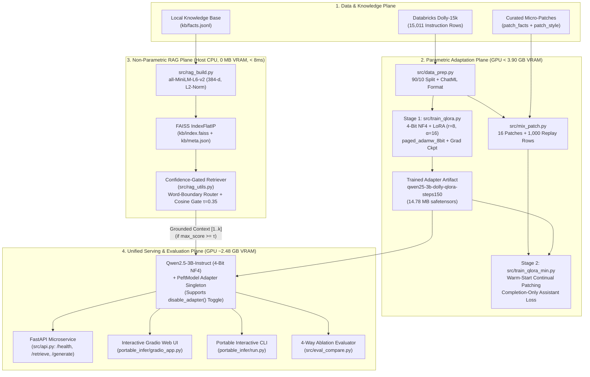
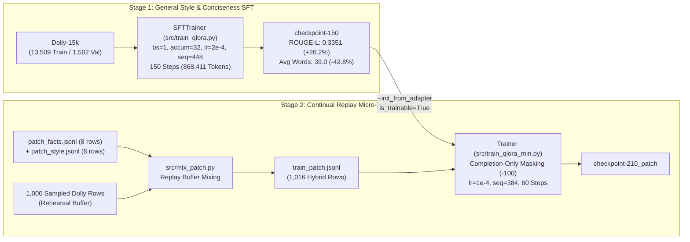
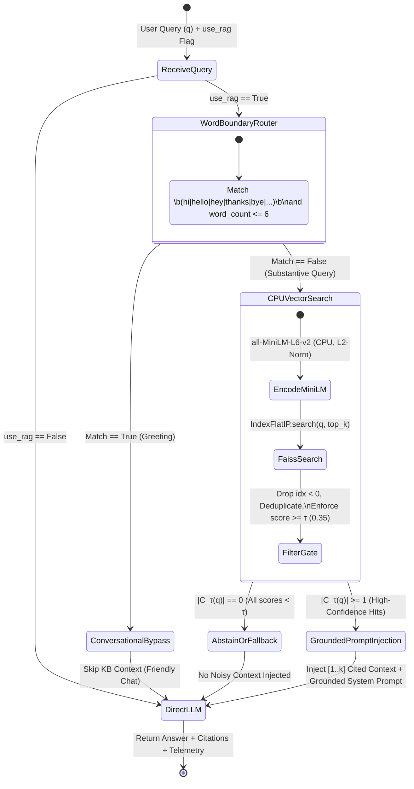
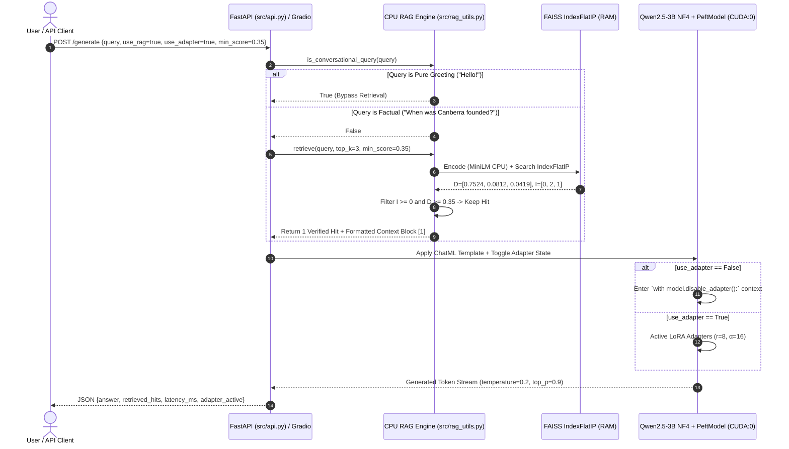

# System Architecture & Mathematical Foundations

> [!IMPORTANT]
> **Architectural North Star**: Designing an end-to-end Large Language Model adaptation and grounded inference system that trains and serves a **3.09-billion-parameter** instruction model (`Qwen/Qwen2.5-3B-Instruct`) strictly inside a **4.0 GB consumer GPU VRAM ceiling**, while solving the **Specialization–Hallucination Paradox** through **Asymmetric CPU–GPU Co-Execution** (`4-bit NF4 QLoRA` on GPU + `Confidence-Gated FAISS Vector Retrieval` on CPU).

---

## Table of Contents

1. [End-to-End Hybrid System Topology](#1-end-to-end-hybrid-system-topology)
2. [Mathematical Foundations of 4-Bit QLoRA](#2-mathematical-foundations-of-4-bit-qlora)
3. [Byte-Level 4.0 GB VRAM Budget & Memory Engineering](#3-byte-level-40-gb-vram-budget--memory-engineering)
4. [Training & Continual Replay Patching Architecture](#4-training--continual-replay-patching-architecture)
5. [Asymmetric CPU–GPU Co-Execution & Confidence-Gated RAG](#5-asymmetric-cpugpu-co-execution--confidence-gated-rag)
6. [Multi-Surface Serving Layer & In-Place Adapter Toggling](#6-multi-surface-serving-layer--in-place-adapter-toggling)

---

## 1. End-to-End Hybrid System Topology

The system cleanly decouples **parametric style adaptation** (handled by low-rank attention adapters on the GPU) from **non-parametric factual recall** (handled by a zero-VRAM dense vector index on the host CPU):

---

## 2. Mathematical Foundations of 4-Bit QLoRA

### 2.1 4-Bit NormalFloat (`NF4`) & Double Quantization
Pre-trained neural network weights follow a zero-centered normal distribution $W \sim \mathcal{N}(0, \sigma^2)$. Standard uniform 4-bit integer quantization (`INT4`) wastes quantization bins in the tails while under-resolving the dense region near zero. **NormalFloat 4-bit (`NF4`)** (Dettmers et al., 2023) is an information-theoretically optimal data type for normally distributed weights that assigns equal probability mass to each of the $2^4 = 16$ quantization bins $q_i \in [-1, 1]$:

$$q_i = \frac{1}{2} \left( Q_X\left(\frac{i}{16 + 1}\right) + Q_X\left(\frac{i+1}{16 + 1}\right) \right), \quad i \in \{0, 1, \dots, 15\}$$

where $Q_X(\cdot)$ is the quantile function of the standard normal distribution $\mathcal{N}(0, 1)$.

To prevent outlier weights from distorting an entire weight matrix, `NF4` quantizes weights in contiguous blocks of size $B_1 = 64$, storing one FP32 absmax scaling constant $c_1^{\text{FP32}}$ per block:

$$W_{\text{NF4}} = \text{round}_{\text{NF4}}\left(\frac{W}{c_1^{\text{FP32}}}\right), \quad c_1^{\text{FP32}} = \max_{j \in \text{block}_{64}} |W_j|$$

**Double Quantization (`bnb_4bit_use_double_quant=True`)** quantizes the first-level scaling constants $c_1^{\text{FP32}}$ themselves into 8-bit floating-point values $c_1^{\text{FP8}}$ in super-blocks of $B_2 = 256$ blocks with a second-level scale $c_2^{\text{FP32}}$:
- **Single-Quantization Scale Overhead**: $\frac{32\text{ bits}}{64\text{ weights}} = 0.500\text{ bits/parameter}$.
- **Double-Quantization Scale Overhead**: $\frac{8\text{ bits}}{64\text{ weights}} + \frac{32\text{ bits}}{64 \times 256\text{ weights}} = 0.125 + 0.00195 \approx \mathbf{0.127\text{ bits/parameter}}$.
- Across `3.09B` parameters, Double Quantization saves:

$$\Delta M_{\text{DQ}} = 3.09 \times 10^9 \times \frac{0.500 - 0.127}{8}\text{ bytes} \approx \mathbf{144.1\text{ MB of GPU VRAM}}$$

---

### 2.2 Low-Rank Adaptation (`LoRA`) on Grouped-Query Attention (GQA)
`Qwen/Qwen2.5-3B-Instruct` comprises $L = 36$ Transformer decoder layers with hidden dimension $d_{\text{model}} = 2048$, $H_q = 16$ query attention heads ($d_{\text{head}} = 128$), and $H_{kv} = 2$ key-value heads (Grouped-Query Attention, $8:1$ GQA ratio, so $d_{kv} = 2 \times 128 = 256$).

For each frozen 4-bit linear projection $W_0 \in \mathbb{R}^{d_{\text{out}} \times d_{\text{in}}}$ in `target_modules = ["q_proj", "k_proj", "v_proj", "o_proj"]`, LoRA injects a trainable low-rank residual parameterized by $A \in \mathbb{R}^{r \times d_{\text{in}}}$ and $B \in \mathbb{R}^{d_{\text{out}} \times r}$ with rank $r = 8 \ll \min(d_{\text{in}}, d_{\text{out}})$ and scaling constant $\alpha = 16$:

$$h = \text{dequant}_{\text{bf16}}(W_0^{\text{NF4}}) x + \Delta W x = \text{dequant}_{\text{bf16}}(W_0^{\text{NF4}}) x + \frac{\alpha}{r} B A x$$

where $A \sim \mathcal{N}(0, \sigma^2)$, $B = \mathbf{0}$ at initialization (ensuring $\Delta W = 0$ at step 0), and the scaling factor is $\frac{\alpha}{r} = \frac{16}{8} = 2.0$.

#### Exact Trainable Parameter Derivation (`qwen25-3b-dolly-qlora-steps150`)
For each of the $L = 36$ layers:
- $\text{params}(q_{\text{proj}}) = r \times (d_{\text{model}} + d_{\text{model}}) = 8 \times (2048 + 2048) = 32,768$
- $\text{params}(k_{\text{proj}}) = r \times (d_{\text{model}} + d_{kv}) = 8 \times (2048 + 256) = 18,432$
- $\text{params}(v_{\text{proj}}) = r \times (d_{\text{model}} + d_{kv}) = 8 \times (2048 + 256) = 18,432$
- $\text{params}(o_{\text{proj}}) = r \times (d_{\text{model}} + d_{\text{model}}) = 8 \times (2048 + 2048) = 32,768$
- **Per-Layer Trainable Parameters**: $32,768 + 18,432 + 18,432 + 32,768 = 102,400\text{ parameters}$.
- **Total Trainable Adapter Parameters ($L = 36$)**:

$$N_{\text{LoRA}} = 36 \times 102,400 = \mathbf{3,686,400\text{ parameters}} \quad (\mathbf{0.119\%}\text{ of } 3.09\text{B})$$

When serialized in FP32 inside `adapter_model.safetensors`, $3,686,400 \times 4\text{ bytes} = 14,745,600\text{ bytes}$ plus safetensors header metadata = **`14,783,648` bytes (`14.78 MB`)**—matching the exact byte size of `adapter_model.safetensors` in `release_qwen25_qlora.zip`.

---

### 2.3 Completion-Only Assistant Cross-Entropy Loss Masking
Given a tokenized ChatML conversation sequence $\mathbf{x} = (x_1, x_2, \dots, x_T)$ partitioned into system/user prompt tokens $x_{1:t_{\text{prompt}}}$ (ending at `<|im_start|>assistant\n`) and assistant response tokens $x_{t_{\text{prompt}}+1:T}$:
- **Standard Causal LM Loss** ([src/train_qlora.py](src/train_qlora.py)): Computes cross-entropy over all tokens $t \in [1, T]$, spending gradient capacity modeling user instructions.
- **Completion-Only Assistant Loss** ([src/train_qlora_min.py](src/train_qlora_min.py)): Sets target labels $y_t = -100$ (PyTorch `ignore_index`) for all $t \le t_{\text{prompt}}$ and computes gradients strictly on assistant completions:

$$\mathcal{L}_{\text{comp}}(\theta_{\text{LoRA}}) = -\frac{1}{T - t_{\text{prompt}}} \sum_{t = t_{\text{prompt}} + 1}^{T} \log P_{\theta_0 + \Delta\theta_{\text{LoRA}}}\left(x_t \;\middle|\; x_{<t}\right)$$

During short continual micro-patching runs (`60` steps on `train_patch.jsonl`), completion-only masking concentrates $100\%$ of the gradient norm onto the target factual answer and tone-rewrite tokens.

---

## 3. Byte-Level 4.0 GB VRAM Budget & Memory Engineering

Why standard FP16 fine-tuning of a 3.09B model fails on consumer GPUs—and how our 5-pillar memory architecture compresses training peak VRAM by **84% (`~24.2 GB` $\rightarrow$ `3.88 GB`)**:

| Memory Allocation Component | Naive FP16 Fine-Tuning | QLoRA Training (`train_qlora.py`) | Hybrid RAG Inference (`eval_compare.py` / `api.py`) | Engineering Mechanism |
| :--- | :---: | :---: | :---: | :--- |
| **1. Base Model Weights** | `6,180 MB` (`fp16`) | `1,620 MB` (`NF4` + DQ) | `1,620 MB` (`NF4` + DQ) | `4.127 bits/param` via `NF4` + Double Quantization |
| **2. Unquantized LM Head / Norms** | Included above | `480 MB` (`bf16`/`fp16`) | `480 MB` (`bf16`/`fp16`) | `lm_head` & `RMSNorm` kept in 16-bit for numerical stability |
| **3. Trainable LoRA Weights** | N/A (Full weights) | `15 MB` | `15 MB` | Only `3.69M` parameters (`0.12%`) attached to `q/k/v/o_proj` |
| **4. Gradients + Optimizer States** | `12,360 MB` (FP32 Adam) | `650 MB` | `0 MB` (`inference_mode`) | `paged_adamw_8bit` + Unified Memory CPU page eviction on spikes |
| **5. Forward Activations / KV Cache** | `5,600 MB+` | `1,115 MB` (`seq=448, bs=1`) | `365 MB` (`use_cache=True`) | Non-reentrant Gradient Checkpointing ($O(\sqrt{L})$ activation memory) |
| **6. Dense Retriever (`MiniLM` + `FAISS`)** | `120 MB` (if on GPU) | `0 MB` | **`0 MB` GPU VRAM** |Pinned to Host CPU (`device="cpu"`, `~90 MB` System RAM) |
| **Total Peak GPU VRAM** | **`~24,260 MB` (OOM)** | **`3,880 MB` (`3.88 GB`)** | **`2,480 MB` (`2.48 GB`)** | **Fits strictly under `4,096 MB` (`4.0 GB`) hardware wall** |

---

## 4. Training & Continual Replay Patching Architecture

---

## 5. Asymmetric CPU–GPU Co-Execution & Confidence-Gated RAG

### 5.1 Mathematical Formulation of Unit-Norm Inner-Product Gating
In [src/rag_build.py](../src/rag_build.py) and [src/rag_utils.py](../src/rag_utils.py), every knowledge-base document $d_i \in \mathcal{D}$ (`title + "\n\n" + text`) and every incoming user query $q$ is encoded via `sentence-transformers/all-MiniLM-L6-v2` ($f_{\text{enc}}: \mathcal{V}^* \rightarrow \mathbb{R}^{384}$) with explicit $\ell_2$ normalization:

$$\hat{q} = \frac{f_{\text{enc}}(q)}{\|f_{\text{enc}}(q)\|_2}, \quad \hat{d}_i = \frac{f_{\text{enc}}(d_i)}{\|f_{\text{enc}}(d_i)\|_2}, \quad \|\hat{q}\|_2 = \|\hat{d}_i\|_2 = 1$$

Because both vectors lie on the unit hypersphere $\mathbb{S}^{383}$, the exact inner product computed by `faiss.IndexFlatIP(384)` is mathematically identical to cosine similarity:

$$s_i = \langle \hat{q}, \hat{d}_i \rangle_{\mathbb{R}^{384}} = \|\hat{q}\|_2 \|\hat{d}_i\|_2 \cos(\theta_{q, d_i}) = \cos(\theta_{q, d_i}) \in [-1, 1]$$

Given top-$k$ candidate pairs $\{(I_r, D_r)\}_{r=1}^k$ returned by `_index.search(q, top_k)`, the **Confidence Gate** constructs the filtered context set $\mathcal{C}_{\tau}(q)$ by enforcing three invariants:

$$\mathcal{C}_{\tau}(q) = \Big\{ d_{I_r} \;\Big|\; r \in \{1, \dots, k\} \;\wedge\; \underbrace{I_r \ge 0}_{\text{No -1 Sentinel}} \;\wedge\; \underbrace{D_r \ge \tau}_{\text{Cosine Gate}} \;\wedge\; \underbrace{\text{title}(d_{I_r}) \notin \text{seen\_titles}}_{\text{Deduplication}} \Big\}$$

### 5.2 Retrieval & Intent Routing State Machine

---

## 6. Multi-Surface Serving Layer & In-Place Adapter Toggling

### 6.1 Request Lifecycle Sequence Diagram

### 6.2 Single-Model In-Place Base vs. Adapter Evaluation ([src/eval_compare.py](../src/eval_compare.py))
In legacy `v1.0`, `eval_compare.py` called `load_base()` and `load_adapter()` simultaneously—instantiating **two** independent 3.09B models on `cuda:0` (`~3.8 GB+` static weight allocation before KV cache), causing severe memory pressure on 4 GB GPUs.

In `v2.0`, `eval_compare.py` loads `AutoModelForCausalLM` **once** and wraps it with `PeftModel.from_pretrained(base, adapter_dir)`. Because PEFT computes $h = W_0 x + \frac{\alpha}{r} B A x$ dynamically via forward hooks, wrapping the base generation call inside `with model.disable_adapter():` bypasses the $\frac{\alpha}{r} B A x$ branch with **zero memory duplication** and **zero weight reloading**.
